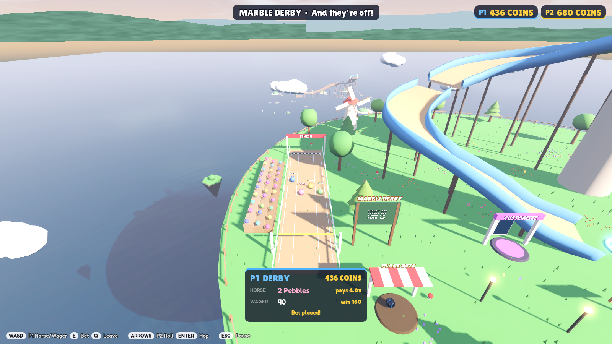
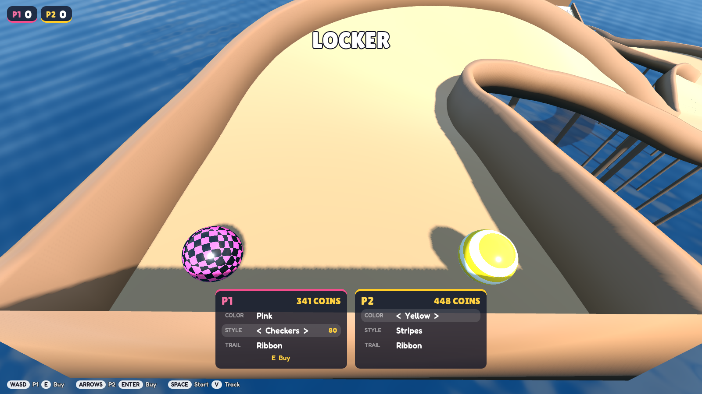

# Rack & Ruin

A party game where friends build a bowling lane together, then race physics marbles down it to smash one shared rack of pins. Built with Godot 4.


## What's in the prototype

The game opens on the **MARBLES 4P** title screen (a working title), with the camera slowly circling the island. From there:

- **Play** picks the number of players (1 to 4), how many frames (3, 5 or 10) and whether marbles bump, then starts a local match on the Customize screen.
- **Practice Island** drops everyone onto a small floating island to roll about, hop and try things out (see below).
- **Online** is a placeholder marked "soon".
- **Settings** has fullscreen, vsync, volume, camera shake and an FPS counter. Settings and the last match options are saved on this computer (`user://settings.cfg`).
- **Controls**, **Credits** and **Quit**.

During a match, **Esc** opens the pause menu.

### Practice Island


A small floating island to warm up on. Roll with your lean keys (forward is away from the camera) and hop with your place key. Nothing here counts.

- **Practice run:** a winding track down from the stone START tower, with a gap to hop and a steep drop. It ends on the plaza, where a big blue pad sends you straight back to the top. The **PRACTICE RUN** pad on the plaza takes you up too.
- **Customize plate:** roll onto the pink pressure plate under the CUSTOMIZE arch. Your marble is parked on the plate and your Customize panel opens (same controls as before a match). Press your turn key (Q for P1) when you're done and you roll off.
- **Marble Derby** (west lawn): a betting minigame. Roll onto the gold PLACE BETS plate, pick one of four marble "horses" (Thunder, Pebbles, Biscuit, Comet) with left and right, set your wager with up and down (10 coins a step), and press your place key to bet. The race starts 6 seconds after the first bet, so friends can join in. Each race the horses get a random form, and the odds board shows what each one pays (a favourite might pay 2x, a long shot 7x). Win and you get your wager times the odds; lose and the wager is gone. Press your turn key to leave.
- **Your coins** show in the top right corner the whole time you're on the island.
- An empty plot on the east lawn is saved for the next minigame.
- **Hurdles** to practise hops, and a few real pieces (bumpers, a booster, a spinner, a jump ramp) to play with.
- **PLAY arch:** roll through it to start a match with the options from the Play page.
- Fall off the edge and you pop back on the plaza. **Esc** opens the pause menu, where Retry puts everyone back at the start.



The island is built in code in `scripts/hub.gd` (the derby is `scripts/horse_race.gd`): windmill, pond and waterfall, trees, flowers, lanterns, butterflies, drifting clouds and little floating rocks.


Before each match, everyone picks their marble's look in the **Customize & Store** (see below). Then each frame has four steps, like the design doc:

1. **Draft (15 s):** a crate opens with one piece per player plus 2 extras, shown as big picture cards in the middle of the screen. Each player steers their own pointer onto a card and grabs it. First to grab a piece gets it.
2. **Build (30 s):** everyone slides their piece anywhere on the lane, turns it, and drops it, all at the same time. A ring shows your cursor and turns red where the piece won't fit. Your piece's name floats above it, and coloured arrows on the floor show which way marbles will roll through it. Pieces stay on the lane for the rest of the match.
3. **Roll (45 s max):** marbles drop through the START arch together, crash into each other, and race to one shared rack of 28 pins. You can lean your marble and give it a small **hop** (your place key), but the lane does most of the work.
4. **Score:** pins are credited and a scoreboard shows every player's points for each frame plus the running total. Hold **Tab** to see it at any time.

A match is 10 frames. Every match starts on a new random track that winds left and right, banks through its corners and has at least one steep drop, high above the water. Some tracks also have a gap. It starts empty. A marble that flies off the track splashes into the water and is out for that frame.

### Hopping and gaps

While rolling, tap your place key (E for P1, Enter for P2) to hop. It's a small hop, about 0.8 m (not enough to clear the walls), and only works when your marble is touching the floor, so you can't fly. Hop just before a **gap** in the track to clear it. Miss, and your marble falls in and is out for the frame, just like flying off the edge. A random track has at most one gap. Fast marbles can sometimes fly a gap without hopping. You can also hop over small pieces like gutter cuts and carpet strips.

### Customize & Store



Before each match the camera sits behind the marbles and each player gets a panel. Move up and down to pick a row (Color, Style, Trail) and left and right to flip through looks. Looks you own go on your marble straight away. Looks you don't own show their price, and your place key (E for P1, Enter for P2) buys them.

- **Styles:** Gloss, Stripes, Chrome, Checkers, Swirl, Neon, Glass, Lava, Galaxy. Patterns are painted on the ball, so you can see it roll.
- **Trails:** Ribbon, Sparkles, Bubbles, Flame, Rainbow.
- **Coins:** you get 1 coin per point you score each frame. At the end of a match everyone gets +20 and the winner gets +50 more. New players start with 150. Coins and purchases are saved on this computer for each player seat (P1, P2 and so on).
- Prices and looks live in `scripts/cosmetics.gd`, and coin amounts in `scripts/profiles.gd`.

### Pieces

Track-altering cards (**TAs** for short) are in the same draft pool as everything else. In the game they're marked **Track Altering**, with a gold badge and gold name on their cards. Every crate has at least one TA. They work a little differently from pieces:

- A coloured bar goes across the whole track. You only slide it up and down the track, not side to side.
- The new stretch of track it adds shows as a striped yellow ribbon with little rails, starting at the bar. The rest of the track after it shows faintly, so you can see where everything ends up. A gap shows as a red patch.
- For bends and hairpins, your rotate key flips the turn between **LEFT** and **RIGHT**. The floating label and your chip at the bottom of the screen say which way it's set.
- The label says **BLOCKED** (and the bar turns red) where the new shape would run into the track or the pin deck.

Pieces further down the track move with it, and the pins move to the new end.

| Piece | What it does |
| --- | --- |
| Bumper post | Round post that kicks marbles sideways |
| Angled rail | Short wall that turns a marble 45 degrees |
| Ramp jump | Launches a marble into the air |
| Carpet strip | Drains speed from anything rolling over it |
| Booster pad | Fires a marble the way its arrow points (rotate it to aim) |
| Spinner | A paddle that never stops turning and swats marbles around |
| Gutter cut | A hole: fall in and your frame is over. Whoever placed it gets +2 |
| Curve wall | Curved wall that swings marbles across the lane |
| Ledge | Ramp up onto a ledge, then a sudden drop |
| Hump | Smooth hill across the lane that tosses marbles up |
| Washboard | Row of little bumps that make marbles hop and skid |
| Tilt table | A square of lane that rocks side to side |
| TA: Track Bend | Changes the track itself: adds a bend, left or right (rotate key flips it) |
| TA: Cliff Drop | Changes the track itself: adds a steep drop |
| TA: Hairpin | Changes the track itself: adds a tight U-turn, left or right (rotate key flips it) |
| TA: Gap Jump | Changes the track itself: adds a short gap that marbles have to hop over |
| Teleporter | Placed in two parts: drop the blue entry, then the orange exit (its arrow is the way marbles come out). A marble that rolls onto the entry pops out of the exit at the same speed. Each marble can use it once per frame |
| Wind Fan | A big fan that blows any marble in front of it the way it faces. It starts blowing across the track; turn it to blow marbles toward a wall, off an open edge, or down the track |
| TA: Wall Breaker | Takes the side walls off 10 m of track from where you drop it, without changing its shape. The stretch shows red and white stripes while you place it |
| Bomb (item) | Drop it on the lane to blow up every piece inside the red circle. It doesn't stay |

## How to play it

1. **Install Godot.** Download **Godot 4.4 or newer, the standard version** (not ".NET") from <https://godotengine.org/download>. On Windows it's a zip file: unzip it anywhere and double-click the `Godot_v4...exe` inside. There's no installer.
2. **Download this project.** On the GitHub page for this repository, click the green **Code** button, then **Download ZIP**. Unzip it somewhere you'll find it again, like your Documents folder.
   - To test a branch that isn't merged yet, first pick it in the branch menu (top left of the file list, it says `main`), then click **Code → Download ZIP**.
3. **Open it in Godot.** In the Godot Project Manager, click **Import**, browse into the unzipped folder, pick the `project.godot` file, and click **Import & Edit**. The first open takes a few seconds while Godot prepares the files.
4. **Press Play.** Click the ▶ button at the top right of the editor (or press **F5**). The game opens in its own window.

## Controls

| | Player 1 | Player 2 |
| --- | --- | --- |
| Draft: move pointer / grab | W A S D / E | Arrows / Enter |
| Build: move / rotate (flip for track cards) / place | W A S D / Q / E | Arrow keys / Right Shift / Enter |
| Roll: lean / hop | W A S D / E | Arrow keys / Enter |

| Key | What it does |
| --- | --- |
| **Space** | Start the match / go to the next frame |
| **Tab** (hold) | Show the scoreboard |
| **R** | Re-roll this frame on the same lane |
| **C** | Turn marble-vs-marble collision on or off |
| **V** | Switch between the follow camera and an overhead view |
| **Esc** | Pause menu (resume, retry the frame, settings, or quit to the title screen) |

## Scoring

| Event | Points |
| --- | --- |
| Each pin your marble knocks down (a chain reaction counts for whoever started it) | 1 |
| Clean sweep: you knock down the last pin standing | +5 |
| First / second / third marble to reach the pins (yellow line) | +3 / +2 / +1 |
| Your piece knocks another player's marble out (gutter cut) | +2 |

If every marble reaches the pins, nobody gets the race bonus. If no marble reaches the pins in 30 seconds, nobody scores that frame.

## Tuning the feel

Most numbers you'll want to tweak are editable in the Godot editor without touching code. Click a node, then change the value in the **Inspector** panel on the right.

| What | Where | Setting |
| --- | --- | --- |
| Rescuing stuck marbles | `scenes/main.tscn`, `Main` node | Stuck Time, Rescue Time |
| Steering strength | `scenes/marble.tscn`, root node | Lean Side Force, Lean Forward Force |
| How snappy steering feels | `scenes/marble.tscn`, root node | Lean Attack (how fast a lean builds up), Lean Release (how fast it dies away), Counter Steer Boost (extra push when you steer against a slide) |
| Who the camera follows | `scenes/main.tscn`, `Main` node | Camera Follow: All Marbles keeps every rolling marble in shot; One Marble follows only Camera Player's marble (for online play later). Camera Shake sets how hard crashes shake the screen |
| How far the camera may pull back | `scenes/main.tscn`, `Camera` node | Frame Margin, Max Zoom, Zoom Out Speed, Zoom In Speed |
| How heavy the marble is | `scenes/marble.tscn`, root node | Mass (heavier scatters pins harder) |
| Bumper kick | `scenes/marble.tscn`, root node | Bumper Kick |
| Hop height and how often | `scenes/marble.tscn`, root node | Hop Speed, Hop Cooldown |
| How big pieces are | `scripts/piece_catalog.gd` | `PIECE_SCALE` (1.4). If you change it, scale each piece's `radius` the same way |
| Wind strength | `scripts/wind_fan.gd` | `push` |
| How long a Wall Breaker stretch is | `scripts/piece_catalog.gd` | `OPEN_LENGTH` |
| Lanterns, rocks, islands, buoys | `scenes/course.tscn`, `Decor` node | Lantern Lights, Lantern Spacing, Rock Count, Island Count, Buoy Count |
| Glow, fog and sunlight | `scenes/main.tscn`, `WorldEnvironment` and `Sun` nodes | Glow, Fog, Light Color |
| Pin weight and wobble | `scenes/pin.tscn`, root node | Mass, Center Of Mass |
| The shape of the track | `scenes/course.tscn`, `Track/Path` node | See "Reshaping the track" below |
| Track width, wall height, how much corners bank | `scenes/course.tscn`, `Track` node | Lane Width, Wall Height, Bank Speed, Max Bank Deg |
| Water and sky colours | `shaders/water.gdshader`, `shaders/sky.gdshader` | The `uniform` lines at the top |
| Players, frames, timers, crate size, collision | `scenes/main.tscn`, `Main` node | Player Count, Frames Per Match, Draft Time, Build Time, Crate Extra, Roll Time Limit, Marbles Collide |
| Build area and how close pieces can go | `scenes/course.tscn`, `Track/Placed` node | Half Width, Top Z, End Margin, Overlap Allowed |
| Build cursor speed and rotate step | `scenes/main.tscn`, `Main` node | Cursor Speed, Rotate Step |

### Reshaping the track

Random tracks come from `scripts/track_gen.gd`. To change how they're made, edit the numbers in `_random_segment()` there: how long bends are, how sharply they turn, and how steep drops are.

To play on a track you've drawn yourself instead, click the **Main** node in `scenes/main.tscn` and untick **Random Track**. Then reshape it by dragging points:

1. Open `scenes/course.tscn` and click **Path** (under **Track**) in the Scene panel.
2. Orange dots appear along the track in the 3D view. Drag one and the floor, walls and posts follow it straight away. Drag a dot up or down to make that part steeper or flatter.
3. To add a point, pick the **Add Point** button in the toolbar above the 3D view and click near the track. Use **Delete Point** to remove one.
4. Each point also has little handles. Dragging them changes how sharply the track curves through that point.
5. Keep the last stretch straight and lined up with the pin deck so the pin deck lines up, and keep the slope going downhill everywhere (about 10 to 20 degrees) so marbles never get stuck.

Tight corners send marbles over the wall, which is half the fun, but a corner sharper than about 4 m across will make the walls fold over each other.

### Fonts

Text uses two free fonts, both under the SIL Open Font License (the licence files are in `fonts/`):
- **Lilita One** by Juan Montoreano for titles and big numbers
- **Fredoka** by the Fredoka Project Authors for everything else (set for the whole game in `ui/theme.tres`)

## How the project is laid out

```
scenes/
  main.tscn          the game: lane, rack, camera, scoreboard
  course.tscn        the track curve, pin deck, and water
  marble.tscn        a player's marble
  pin.tscn           one bowling pin
  pieces/            every lane piece, one scene each
scripts/
  main.gd            runs frames and the match (the "referee")
  marble.gd          lean steering and bumper kicks
  pin.gd             knocked-down check and who gets credit
  rack.gd            sets up the 28 pins
  scoring.gd         the scoring rules, on their own
  piece_catalog.gd   the list of draftable pieces (add new ones here)
  draft_build.gd     draft and build rules
  cosmetics.gd       every marble look and its price
  profiles.gd        each seat's coins, purchases and equipped look (saved)
  marble_trail.gd    marble trails (ribbon, sparkles, flame and so on)
  track_gen.gd       makes random track layouts and applies track cards
  track.gd           builds the track's floor, walls and posts from the curve
  course_builder.gd  the build area, placed pieces, and the bomb
  teleporter.gd      the two-part teleporter pad
  wind_fan.gd        the wind fan piece
  hub.gd             the practice island (practice run, Customize plate, PLAY arch)
  horse_race.gd      the Marble Derby betting minigame
  main_menu.gd       title screen, Play/Settings/Controls/Credits pages, pause menu
  game_settings.gd   saved settings (screen, sound, camera, match options)
  decor.gd           start/finish arches, lanterns, braces, rocks, islands, buoys
  thumbnails.gd      live pictures of each piece for the draft cards
  booster_pad.gd, carpet_strip.gd, gutter_cut.gd, spinner.gd, tilt_table.gd   piece behaviour
  controls.gd        all the key bindings
  camera_rig.gd      follow camera
  hud.gd             everything on screen: scores, draft cards, Customize screen, scoreboard
fonts/               the two fonts and their licences
ui/theme.tres        default font and text size for all menus
shaders/
  marble.gdshader    marble patterns (stripes, swirl, galaxy, lava...)
  sky.gdshader       the sky, clouds and distant hills
  water.gdshader     the moving water
tests/
  test_scoring.gd    checks the scoring rules
  sim_roll.gd        plays frames with no one at the keys and prints results
  sim_items.gd       tries the teleporter, wind fan and Wall Breaker
  sim_gap.gd         rolls over a gap, with or without well-timed hops
  sim_hub.gd         checks the practice island's teleports, Customize plate, derby bet and PLAY arch
```

The code is set up for online play later: `main.gd` makes every decision (physics, who arrived first, who gets each pin), and player input only reaches the game through two functions: `_gather_inputs()` for marble lean and `_gather_build_inputs()` for draft and build requests. When online play arrives, the host runs `main.gd` and fills those in from the network instead of the keyboard.

### Running the tests (optional)

From the project folder in a terminal, with `godot` being the path to your Godot program:

```
godot --headless --script res://tests/test_scoring.gd
godot --headless --fixed-fps 120 --script res://tests/sim_roll.gd
godot --headless --fixed-fps 120 --script res://tests/sim_gap.gd -- hop
```
