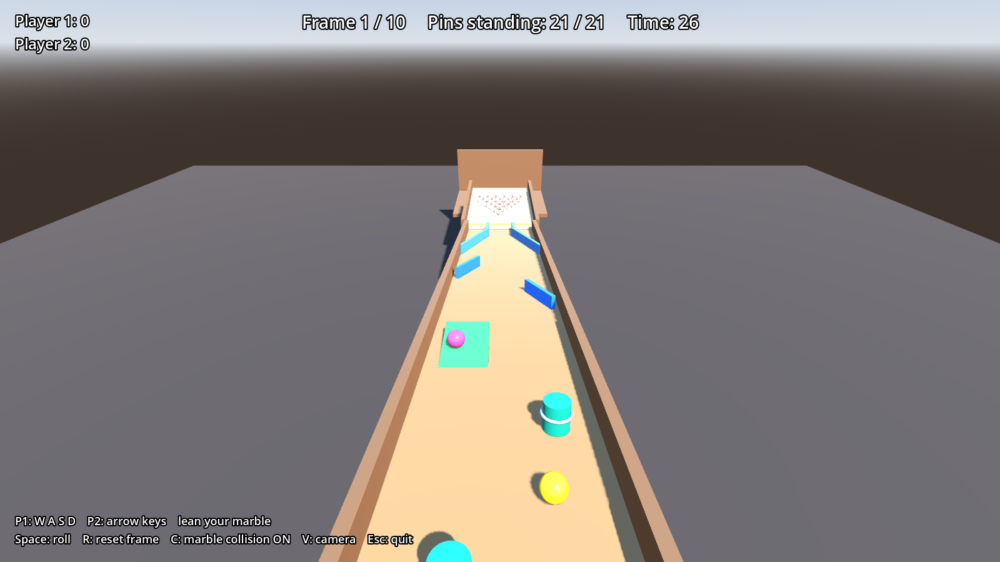

# Rack & Ruin

A party game where friends build a bowling lane together, then race physics marbles down it to smash one shared rack of pins. Built with Godot 4.




## What's in the prototype

Each frame has four steps, like the design doc:

1. **Draft (15 s):** a crate opens with one piece per player plus 2 extras, shown as picture cards down the right side. Everyone grabs one at the same time. First to grab a piece gets it.
2. **Build (30 s):** everyone slides their piece anywhere on the lane, turns it, and drops it, all at the same time. A ring shows your cursor and turns red where the piece won't fit. Pieces stay on the lane for the rest of the match.
3. **Roll (45 s max):** marbles drop together, crash into each other, and race to one shared rack of 21 pins. You can lean your marble, but the lane does most of the work.
4. **Score:** pins are credited and a scoreboard shows every player's points for each frame plus the running total. Hold **Tab** to see it at any time.

A match is 10 frames. Every match starts on a new random track that winds left and right, banks through its corners and has at least one steep drop, high above the water. It starts empty except for a funnel in front of the pins. A marble that flies off the track splashes into the water and is out for that frame.

### Pieces

Every crate has at least one track card. While you place a track card, a yellow see-through track shows the new shape from your cursor onward. The ring turns red where the new shape would run into the track or the pin deck. Pieces further down the track move with it, and the pins move to the new end.

| Piece | What it does |
| --- | --- |
| Bumper post | Round post that kicks marbles sideways |
| Angled rail | Short wall that turns a marble 45 degrees |
| Ramp jump | Launches a marble into the air |
| Carpet strip | Drains speed from anything rolling over it |
| Booster pad | Fires a marble the way its arrow points (rotate it to aim) |
| Spinner | A paddle that never stops turning and swats marbles around |
| Gutter cut | A hole: fall in and your frame is over. Whoever placed it gets +2 |
| Bend | Curved wall that swings marbles across the lane |
| Drop step | Ramp up onto a ledge, then a sudden drop |
| Hump | Smooth hill across the lane that tosses marbles up |
| Washboard | Row of little bumps that make marbles hop and skid |
| Tilt table | A square of lane that rocks side to side |
| Track: bend | Changes the track itself: adds a bend where you drop it, turning toward the side you drop it on |
| Track: cliff drop | Changes the track itself: adds a steep drop where you drop it |
| Track: hairpin | Changes the track itself: adds a tight U-turn, toward the side you drop it on |
| Bomb (item) | Drop it on the lane to blow up every piece inside the red circle. It doesn't stay |

## How to play it

1. **Install Godot.** Download **Godot 4.4 or newer, the standard version** (not ".NET") from <https://godotengine.org/download>. On Windows it's a zip file: unzip it anywhere and double-click the `Godot_v4...exe` inside. There's no installer.
2. **Download this project.** On the GitHub page for this repository, click the green **Code** button, then **Download ZIP**. Unzip it somewhere you'll find it again, like your Documents folder.
   - To test a branch that isn't merged yet, first pick it in the branch menu (top left of the file list, it says `main`), then click **Code → Download ZIP**.
3. **Open it in Godot.** In the Godot Project Manager, click **Import**, browse into the unzipped folder, pick the `project.godot` file, and click **Import & Edit**. The first open takes a few seconds while Godot prepares the files.
4. **Press Play.** Click the ▶ button at the top right of the editor (or press **F5**). The game opens in its own window.

## Controls

| | Player 1 | Player 2 |
| --- | --- | --- |
| Draft: choose / grab | W S / E | Up Down / Enter |
| Build: move / rotate / place | W A S D / Q / E | Arrow keys / Right Shift / Enter |
| Roll: lean | W A S D | Arrow keys |

| Key | What it does |
| --- | --- |
| **Space** | Start the match / go to the next frame |
| **Tab** (hold) | Show the scoreboard |
| **R** | Re-roll this frame on the same lane |
| **C** | Turn marble-vs-marble collision on or off |
| **V** | Switch between the follow camera and an overhead view |
| **Esc** | Quit |

## Scoring

| Event | Points |
| --- | --- |
| Each pin your marble knocks down (a chain reaction counts for whoever started it) | 1 |
| Clean sweep: you knock down the last pin standing | +5 |
| First / second / third marble to reach the pins (yellow line) | +3 / +2 / +1 |
| Your piece knocks another player's marble out (gutter cut) | +2 |

If every marble reaches the pins, nobody gets the race bonus. If no marble reaches the pins in 30 seconds, nobody scores that frame.

## Tuning the feel

Most numbers you'll want to tweak are editable in the Godot editor without touching code. Click a node, then change the value in the **Inspector** panel on the right.

| What | Where | Setting |
| --- | --- | --- |
| Steering strength | `scenes/marble.tscn`, root node | Lean Side Force, Lean Forward Force |
| How heavy the marble is | `scenes/marble.tscn`, root node | Mass (heavier scatters pins harder) |
| Bumper kick | `scenes/marble.tscn`, root node | Bumper Kick |
| Pin weight and wobble | `scenes/pin.tscn`, root node | Mass, Center Of Mass |
| The shape of the track | `scenes/course.tscn`, `Track/Path` node | See "Reshaping the track" below |
| Track width, wall height, how much corners bank | `scenes/course.tscn`, `Track` node | Lane Width, Wall Height, Bank Speed, Max Bank Deg |
| Where the funnel sits | `scenes/course.tscn`, `Track` node | Funnel From End |
| Water and sky colours | `shaders/water.gdshader`, `shaders/sky.gdshader` | The `uniform` lines at the top |
| Players, frames, timers, crate size, collision | `scenes/main.tscn`, `Main` node | Player Count, Frames Per Match, Draft Time, Build Time, Crate Extra, Roll Time Limit, Marbles Collide |
| Build area and how close pieces can go | `scenes/course.tscn`, `Track/Placed` node | Half Width, Top Z, End Margin, Overlap Allowed |
| Build cursor speed and rotate step | `scenes/main.tscn`, `Main` node | Cursor Speed, Rotate Step |

### Reshaping the track

Random tracks come from `scripts/track_gen.gd`. To change how they're made, edit the numbers in `_random_segment()` there: how long bends are, how sharply they turn, and how steep drops are.

To play on a track you've drawn yourself instead, click the **Main** node in `scenes/main.tscn` and untick **Random Track**. Then reshape it by dragging points:

1. Open `scenes/course.tscn` and click **Path** (under **Track**) in the Scene panel.
2. Orange dots appear along the track in the 3D view. Drag one and the floor, walls and posts follow it straight away. Drag a dot up or down to make that part steeper or flatter.
3. To add a point, pick the **Add Point** button in the toolbar above the 3D view and click near the track. Use **Delete Point** to remove one.
4. Each point also has little handles. Dragging them changes how sharply the track curves through that point.
5. Keep the last stretch straight and lined up with the pin deck so the funnel sits flat, and keep the slope going downhill everywhere (about 10 to 20 degrees) so marbles never get stuck.

Tight corners send marbles over the wall, which is half the fun, but a corner sharper than about 4 m across will make the walls fold over each other.

## How the project is laid out

```
scenes/
  main.tscn          the game: lane, rack, camera, scoreboard
  course.tscn        the track curve, pin deck, water, and the funnel
  marble.tscn        a player's marble
  pin.tscn           one bowling pin
  pieces/            every lane piece, one scene each
scripts/
  main.gd            runs frames and the match (the "referee")
  marble.gd          lean steering and bumper kicks
  pin.gd             knocked-down check and who gets credit
  rack.gd            sets up the 21 pins
  scoring.gd         the scoring rules, on their own
  piece_catalog.gd   the list of draftable pieces (add new ones here)
  draft_build.gd     draft and build rules
  track_gen.gd       makes random track layouts and applies track cards
  track.gd           builds the track's floor, walls and posts from the curve
  course_builder.gd  the build area, placed pieces, and the bomb
  thumbnails.gd      live pictures of each piece for the draft cards
  booster_pad.gd, carpet_strip.gd, gutter_cut.gd, spinner.gd, tilt_table.gd   piece behaviour
  controls.gd        all the key bindings
  camera_rig.gd      follow camera
  hud.gd             scoreboard text
shaders/
  sky.gdshader       the sky, clouds and distant hills
  water.gdshader     the moving water
tests/
  test_scoring.gd    checks the scoring rules
  sim_roll.gd        plays frames with no one at the keys and prints results
```

The code is set up for online play later: `main.gd` makes every decision (physics, who arrived first, who gets each pin), and player input only reaches the game through two functions: `_gather_inputs()` for marble lean and `_gather_build_inputs()` for draft and build requests. When online play arrives, the host runs `main.gd` and fills those in from the network instead of the keyboard.

### Running the tests (optional)

From the project folder in a terminal, with `godot` being the path to your Godot program:

```
godot --headless --script res://tests/test_scoring.gd
godot --headless --fixed-fps 120 --script res://tests/sim_roll.gd
```
