# Rack & Ruin

A party game where friends build a bowling lane together, then race physics marbles down it to smash one shared rack of pins. Built with Godot 4.


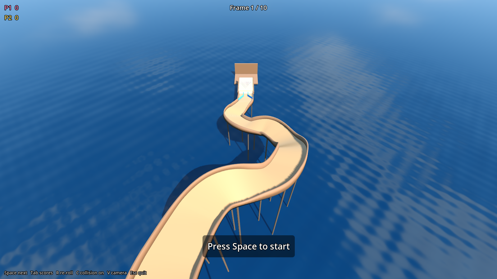

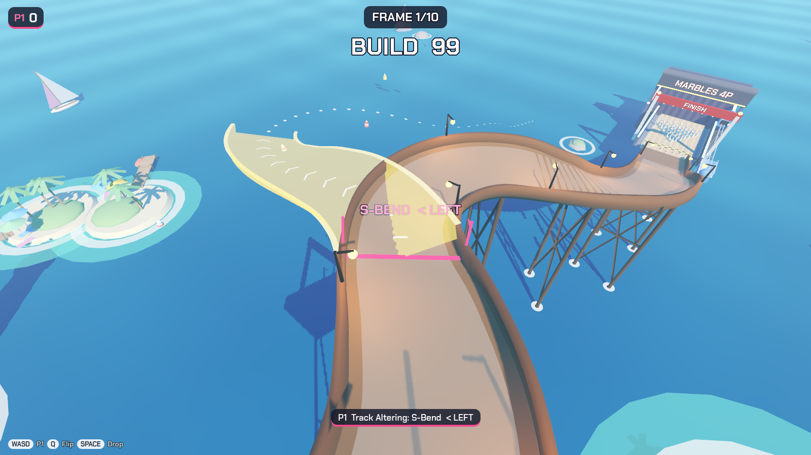

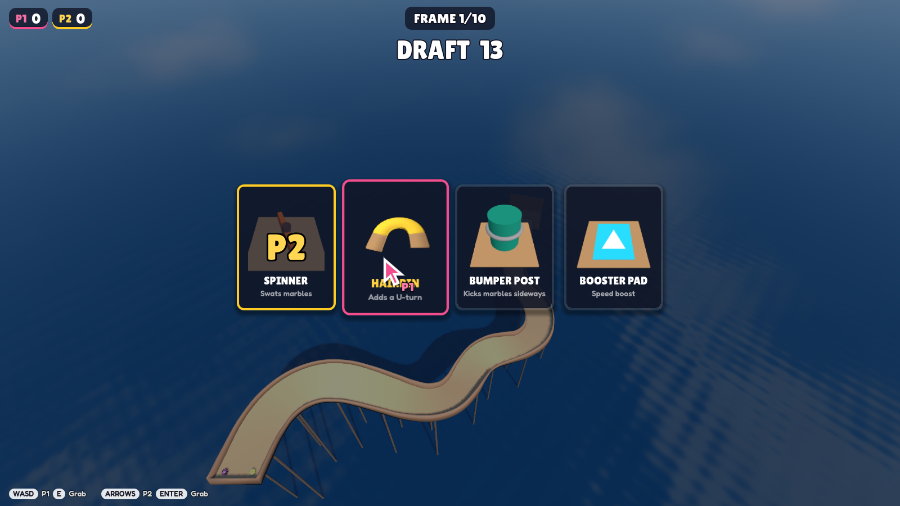

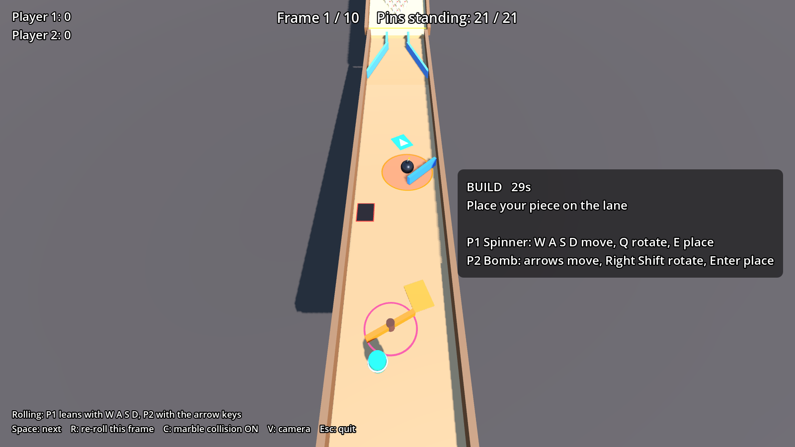

## What's in the prototype

The game opens on the **BOWLING WIP** title screen (a working title; it's `TITLE` at the top of `scripts/main_menu.gd`, and every sign in the game uses it), with the camera slowly circling the island. From there:

- **Play** picks how many people play at this computer (1 to 4), how many **bots** join them (up to four seats in all), how many frames (3, 5 or 10) and whether marbles bump, then starts a local match on a short READY? screen (press Space or Y to start). The default is one person and one bot.
- **The Hub** drops everyone onto a small floating island to roll about, hop and try things out (see below).
- **Online** hosts or joins a game over the internet or your home network (see below).
- **Settings** has fullscreen, vsync, volume, camera shake, strike replay on/off and an FPS counter. Settings and the last match options are saved on this computer (`user://settings.cfg`).
- **How to play** is a short picture guide to a frame: draft a piece, build it into the lane, then roll and smash the pins (see below).
- **Controls**, **Credits** and **Quit**.

During a match, **Esc** opens the pause menu.

### How to play guide

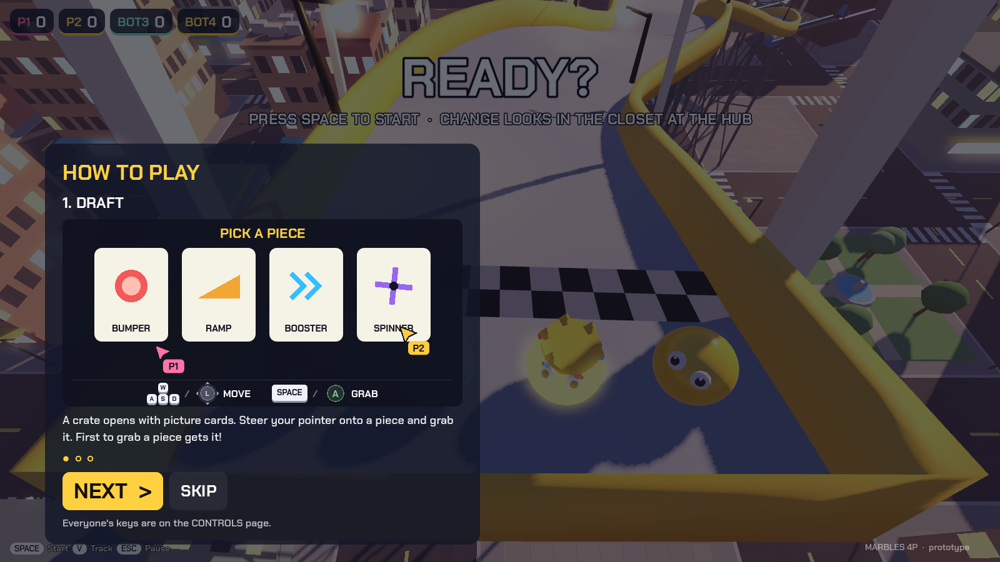

The first time anyone starts a match on this computer, a short guide pops up over the READY? screen. It has three little animated pictures, one per step of a frame: **Draft** (grab a piece card with your pointer), **Build** (slide, turn and drop your piece on a winding lane) and **Roll** (race down the twisty lane to the pins). Under each picture are the buttons for that step, drawn like real keyboard keys and controller buttons (for example the WASD keys or the left stick to move, Space or A to grab). Press **NEXT** (or right) to flip through, **BACK** (or left) to go back, and **GOT IT!** or **SKIP** (or Esc) to start playing. It only pops up once; after that it's always on the title screen under **HOW TO PLAY**. The game remembers you've seen it in `user://settings.cfg`, so deleting that file brings the pop-up back.

The pictures are drawn in code in `scripts/how_to_play.gd`, and the words and button prompts for each step are in the `STEPS` list at the top of that file if you want to change them.

### The Hub

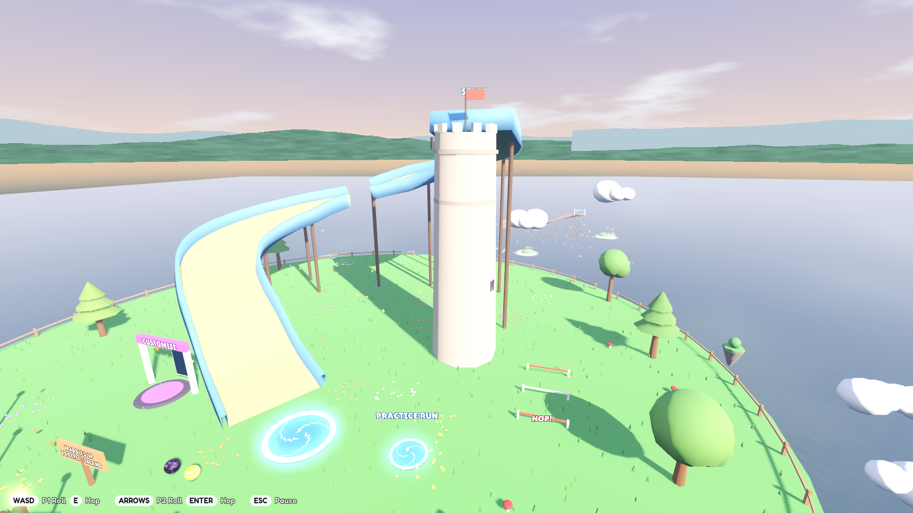

A jungle island to warm up on and explore. It's its own place, high above a sea of clouds with its own sky; the match lake and track are hidden while you're there. Tall mossy rock cliffs ring the island like a jungle valley, with far-off jungle mountains all round, and gorges in the cliffs where the bridges lead out. Roll with your lean keys (forward is away from the camera) and hop with your place key. Nothing here counts.

Only people come to the island (no bots). The camera is a free third-person camera that follows your marble anywhere on the island, so you can explore. Turn it with **Z / X**, the **right stick**, or by holding the **right mouse button** and dragging (drag up and down to look higher or lower), and use the **mouse wheel** to move it closer or further away. If you leave it alone for a second while rolling, it swings round behind you. If a wall or tree gets between the camera and your marble, the camera moves in front of it. With two or more players on one screen, it follows the middle of the group and pulls back to keep everyone in view.

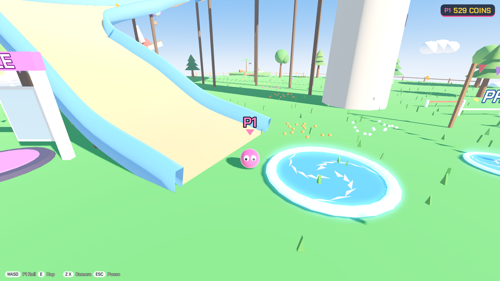

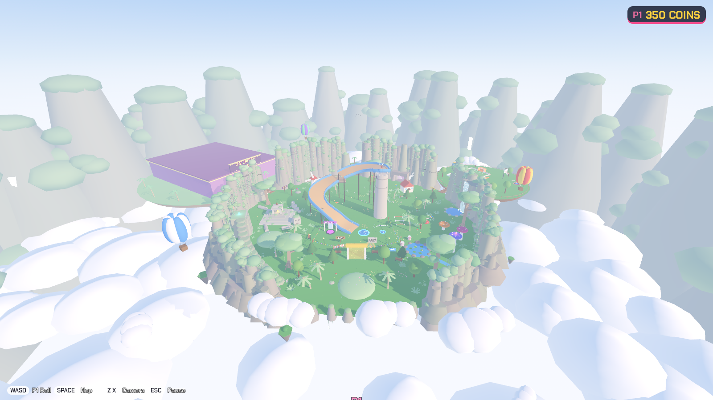

 A coloured name tag (P1, P2...) with a little arrow floats over each marble so you can always find yourself, and it grows when the camera is far away.

- **Practice run:** a winding track down from the stone START tower, with a gap to hop and a steep drop. It ends on the plaza, where a big blue pad sends you straight back to the top. The **PRACTICE RUN** pad on the plaza takes you up too.
- **Customize plate:** roll onto the pink pressure plate under the CUSTOMIZE arch to open your **closet** (see below). One player at a time.
- **Golden Ball Trophy:** anyone who has pulled the ultra-rare trophy gets it on a little stand on the east side of the plaza.
- **Casino island:** a short bridge through the north-west gorge (follow the CASINO sign) leads to **The Groovy Gutter**, an indoor 70s casino (see below). The derby, blackjack, the bar and the loot crates are all in there.
- **Ball Derby** (in the casino): a betting minigame. Roll onto the gold PLACE BETS plate, pick one of four bowling ball "horses" (Frank, Trunk, Fatty and Jakob) with left and right, set your wager with up and down (10 coins a step), and press your place key to bet. The race starts 6 seconds after the first bet, so friends can join in. Each race the horses get a random form, and the odds board shows what each one pays (a favourite might pay 2x, a long shot 7x). Win and you get your wager times the odds; lose and the wager is gone. Press your turn key to leave.
- **Your coins** show in the top right corner the whole time you're on the island.
- **Sports island:** a short wooden bridge through the north-east gorge (follow the SPORTS sign) leads to a second island (see below).
- A rope bridge off the north edge leads to a tiny lookout islet with a little vintage **biplane** on it. Roll into the plane to climb in and fly round the island: left and right turn, forward dives and back climbs, your place key gives a burst of speed and your turn key hops you out (back onto the lookout). It flies itself at a steady speed and won't go too low or too far, so you can't crash. It's built in `scripts/biplane.gd`. There's also a cottage with a smoking chimney and a vegetable garden, benches, bunting over the plaza, hot-air balloons and flocks of birds.
- **Jungle things to explore:** stepped temple ruins with a shrine (and a waving monkey), a giant stone head, broken pillars to hop up, rock steps climbing the south-west cliff to a high ledge, bouncy giant mushrooms (roll onto the little red BOING! one and it bounces you from cap to cap), a hollow log to roll through, a glowing crystal cave in the north-east cliff, a waterfall in the east cliff with a hollow behind it, and grassy hills. Parrots fly overhead, frogs hop between lily pads on the pond, and fireflies and leaves drift about.
- **Secret gems:** six glowing gems are hidden round the jungle (the stone by the spawn says so). Roll into one to collect it: the first time each player finds each gem they get 25 coins, and a message shows how many of the six they've found. Your progress is saved with your coins (`user://profiles.cfg`) and shows next to your coins (◆ 3/6). Gems you've already found come back each visit as faint glass ghosts, so you can see which are left. Find all six to win the **Jungle Gem Crown** hat (a vine circlet with all six gems, rarity *Secret*, never in crates) and the **Treasure Hunter** achievement.
- **Hurdles** to practise hops, and a yard of real practice pieces (bumpers, a booster, a spinner, a jump ramp) behind the start tower, by the PRACTICE PIECES sign.
- **PLAY arch:** roll through it to start a match with the options from the Play page.
- Fall off the edge and you pop back on the plaza. **Esc** opens the pause menu, where Retry puts everyone back at the start.


#### Casino island

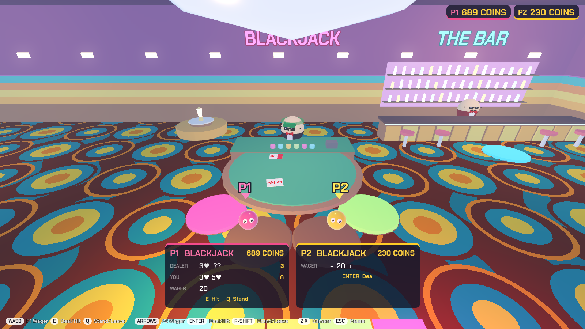

An indoor casino with a groovy 70s theme, built right into a mountain: from outside it looks like the jungle cliffs, with mossy rock columns, vines and jungle over the roof, and only the marquee and door showing. Inside: swirly carpet, wood panels, gently breathing neon signs, a ring of coloured party bulbs under the ceiling that glow up and down in slow waves, a disco ball over the dance floor, a roulette wheel, slot machines, lava lamps, and a marquee of chasing light bulbs out front. Every dealer and the bartender wears shady sunglasses and keeps an eye on the nearest marble.

- **Blackjack:** roll onto one of the four stools round the table. Up and down set your wager (10 coins a step); your place key deals, then **hits** (takes a card); your turn key **stands**. Get closer to 21 than the dealer without going over. The dealer draws until they have 17. A win pays double your wager back, a blackjack (21 with your first two cards) pays 2.5x, and a tie gives your wager back. You can't walk away mid-hand. The cards land on the felt, so people watching can follow along.
- **The bar:** roll onto the plate at the bar, pick a drink with left and right, and order with your place key. Fizzy drinks give your marble the hiccups for a while (little hops and bubbles). Fizzy Lemonade 5 coins, Root Beer Float 10, Galaxy Soda 20 (the biggest hiccups).
- **Loot crates:** the crate machine in the corner (see Loot crates below).
- **Ball Derby:** the horse track along the side wall (see above).

Built in code in `scripts/casino/casino_island.gd`, with blackjack in `scripts/casino/blackjack.gd`.

#### Sports island

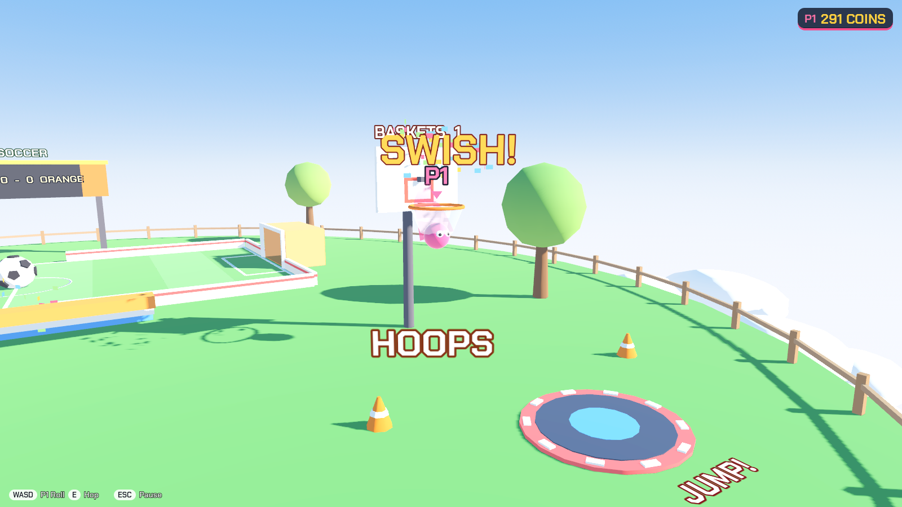

- **Soccer:** a small pitch with a blue goal on the left and an orange goal on the right. Push the big ball into the orange goal to score for blue, and into the blue goal to score for orange. The scoreboard behind the pitch keeps count, everyone gets a GOAL! and confetti, and the ball goes back to the middle for kick-off. If the ball gets knocked off the pitch it comes back to the middle too.
- **Hoops:** roll onto the trampoline set into the ground and it throws you at the basketball hoop. Most throws go in (not all!). A basket gets a SWISH!, a burst of confetti and adds one to the BASKETS count on the backboard.
- Fall off the sports island and you come back on the sports island, not the main one.

It's built in code in `scripts/sports_island.gd`.

The island is built in code in `scripts/hub.gd`, with the jungle (cliffs, ruins, mushrooms, cave, waterfall, gems and critters) in `scripts/jungle.gd` (the derby is `scripts/horse_race.gd`): windmill, pond and waterfall, trees, flowers, lanterns, butterflies, drifting clouds and little floating rocks.


Looks are changed between games in the closet on the hub, not at the start of a match. Each frame has four steps, like the design doc:

1. **Draft (15 s):** a crate opens with one piece per player plus 2 extras, shown as big picture cards in the middle of the screen. Each player steers their own pointer onto a card and grabs it. First to grab a piece gets it.
2. **Build (30 s):** everyone slides their piece anywhere on the lane, turns it, and drops it, all at the same time. A ring shows your cursor and turns red where the piece won't fit. Your piece's name floats above it, and coloured arrows on the floor show which way marbles will roll through it. Pieces stay on the lane for the rest of the match.
3. **Roll (45 s max):** marbles drop through the START arch together, crash into each other, and race to one shared rack of 28 pins. The track is a classic maple bowling lane: thin boards, approach dots, a foul line just past the START arch, guide dots and seven aiming arrows. Each pin has its own little face (most look normal, some are sleepy, googly, happy or grumpy); they blink, squeeze their eyes shut when hit, and stay knocked out once they fall. You can lean your marble a little and give it a small **hop** (your place key), but the lane does most of the work. Once a marble crosses the finish line, steering and hops switch off and it just carries its momentum into the pins.
4. **Score:** pins are credited and a scoreboard shows every player's points for each frame plus the running total. Hold **Tab** to see it at any time.

A match is 10 frames. Every match starts on a new random track that winds left and right, banks through its corners and has at least one steep drop, high above the water. Some tracks also have a gap. It starts empty. A marble that flies off the track splashes into the water and is out for that frame.

### Hopping and gaps

While rolling, tap your place key (E for P1, Enter for P2) to hop. It's a small hop, about 0.8 m, which is just enough to clear the 0.7 m side walls if you want to jump off or cut a corner, and only works when your marble is touching the floor, so you can't fly. Hop just before a **gap** in the track to clear it. Miss, and your marble falls in and is out for the frame, just like flying off the edge. A random track has at most one gap. Fast marbles can sometimes fly a gap without hopping. You can also hop over small pieces like gutter cuts and carpet strips.

### Bots

Pick **BOT SKILL** on the Play page (or in the online lobby): **Easy**, **Normal**, **Hard** or **Expert**. Better bots steer tighter, lean forward harder so they roll faster, hardly ever miss a hop, decide quicker, and drop their pieces right where the marbles roll. The levels are a little table at the top of `scripts/bot.gd` if you want to tune them.

Bots fill empty seats and play by the same rules as people: they wander over to a card in the draft and grab it, slide their piece somewhere down the track and drop it, then roll down the middle of the lane, leaning forward and hopping gaps. They're good but not perfect (they wobble a little). Each bot gets its own random look, always with eyes. Their code is `scripts/bot.gd`: a bot just answers "which way is my stick, and which buttons did I press?" every frame, exactly like a controller, so the referee treats it like anyone else.

### Online play

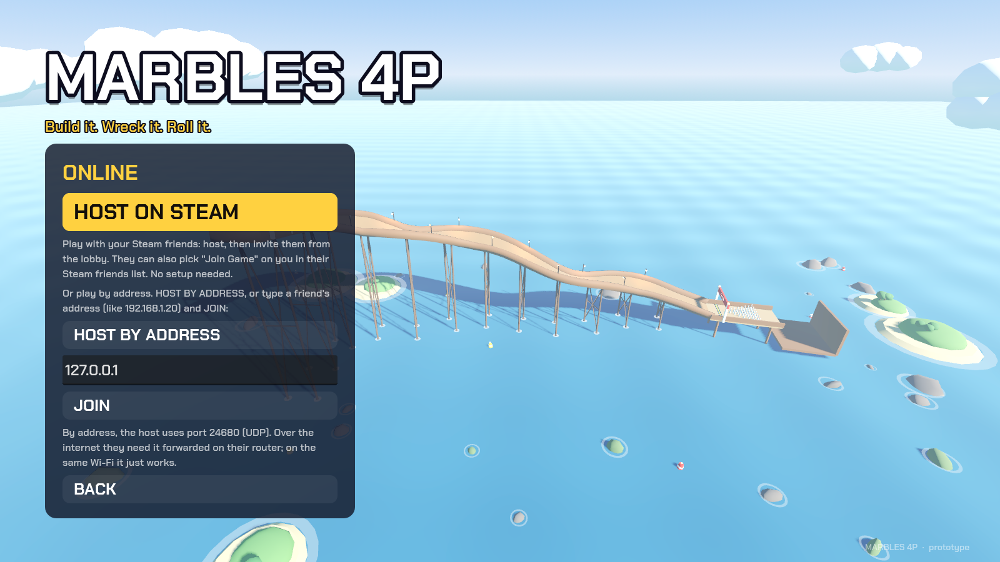

**Over Steam (the easy way).** Needs the GodotSteam plugin and Steam running; see [docs/STEAM.md](docs/STEAM.md).

1. One person picks **ONLINE → HOST ON STEAM**. The game makes a friends-only Steam lobby.
2. In the **LOBBY**, **INVITE STEAM FRIENDS** opens Steam's friends list to send invites. Friends accept the invite, or pick **Join Game** on the host in their Steam friends list. If their game isn't open, Steam starts it and drops them straight into the lobby.
3. Everyone lands on the host's **island** with their Steam name over their marble, and can roll around, open crates, dress up in the closet and bet on the derby together.
4. When you're ready, roll through the **PLAY** arch. Your tag says **READY** (roll through again to take it back). When everyone is ready, a 3-second countdown starts the match. The host can also press **Esc → START NOW**.
5. After the match, everyone goes back to the island, and friends can join again.

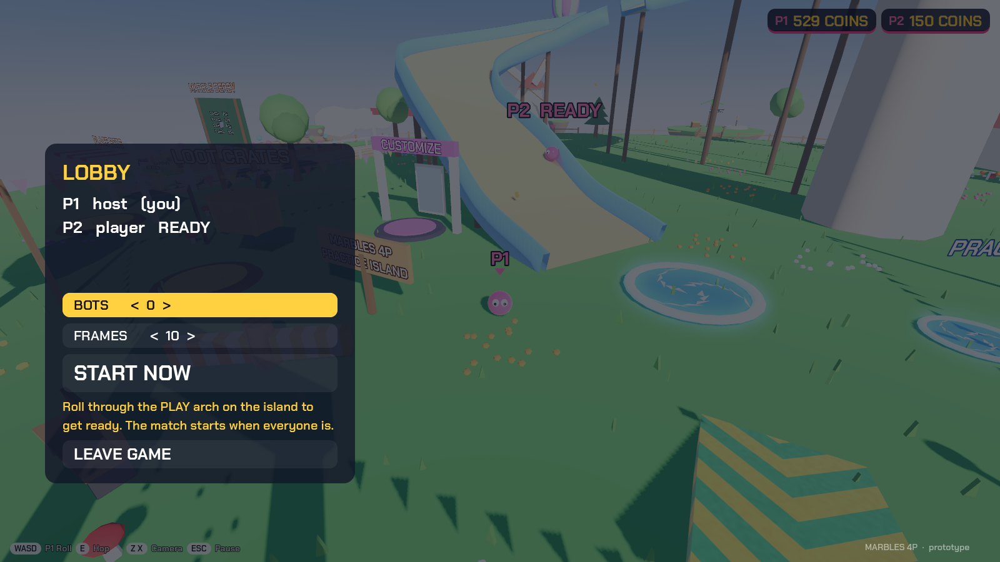

**Esc** on the island opens the lobby: the host can invite friends, add bots and pick the number of frames there.

There's no port forwarding: Steam connects everyone through its own relay network, and nobody sees anyone else's address. Steam play uses `scripts/steam_service.gd`; the App ID is in `scripts/steam_config.gd`.

**By address (works without Steam).**

1. One person picks **ONLINE → HOST BY ADDRESS**. Their computer runs the game.
2. Everyone else picks **ONLINE**, types the host's address and picks **JOIN**. On the same Wi-Fi that's the host's local address (like `192.168.1.20`); over the internet it's the host's public address. To test on one computer, open the game twice and join `127.0.0.1`.
3. Everyone lands on the host's island and readies up, the same as over Steam.

How it works: the host's computer runs the whole game (physics, pins, scoring and the bots). Everyone else's game sends only their stick and button presses to the host and shows what the host sends back about 30 times a second, so everyone sees the same pins fall and nobody can cheat by changing their own copy. Online, each computer plays with the Player 1 keys or the first controller.

- By address, the game uses **port 24680 (UDP)**. Over the internet, the host has to forward that port to their computer in their router's settings ("port forwarding"). You can also type `address:port` to join a different port.
- If someone leaves mid-match, a bot takes over their seat and the match carries on. If the host leaves, the match ends for everyone.
- People can't join a match that has already started (they can join once everyone's back on the island), and retrying a frame is turned off online.
- On the island the host runs the physics too. Each guest opens their closet and crates on their own screen; the new look shows up for everyone when they close it.
- The networking is in `scripts/net.gd`; `main.gd` decides what to send and does what the host says. Steam and an address only differ in how the connection is made: everything after that is the same code.

### Achievements

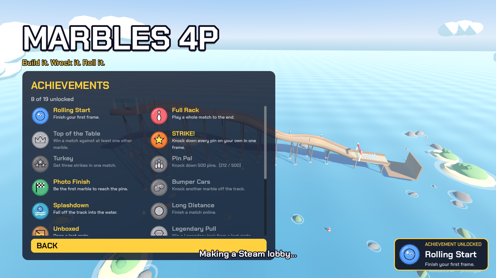

20 achievements, from finishing your first frame to pulling the Golden Ball. **ACHIEVEMENTS** on the title screen shows them all, with progress on counting ones (like 212 / 500 pins). Unlocking one pops up a badge in the corner. They belong to the computer (one Steam account), so any person playing here can earn them, but bots can't, and online each computer earns its own.

They're saved on this computer (`user://achievements.cfg`) and sent to Steam whenever Steam is running, including any you earned while it wasn't. With the test App ID (480) Steam doesn't know them yet; [docs/STEAM.md](docs/STEAM.md) has the list to add on the Steamworks site.

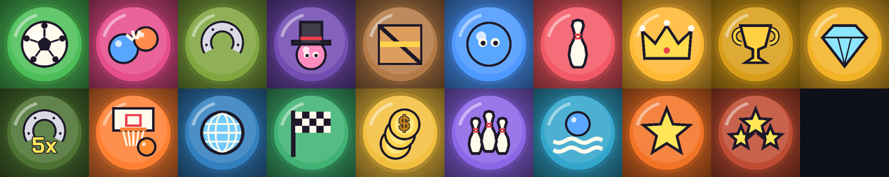

The badges are drawn in code (`scripts/achievement_icon.gd`). `steam/achievements/` has every one as a 256 x 256 PNG, in colour and grey (locked), ready to upload to Steam. To redraw them after a change, run `godot --script res://tools/make_achievement_icons.gd` (not headless). The list itself is `LIST` in `scripts/achievements.gd`.

### The closet

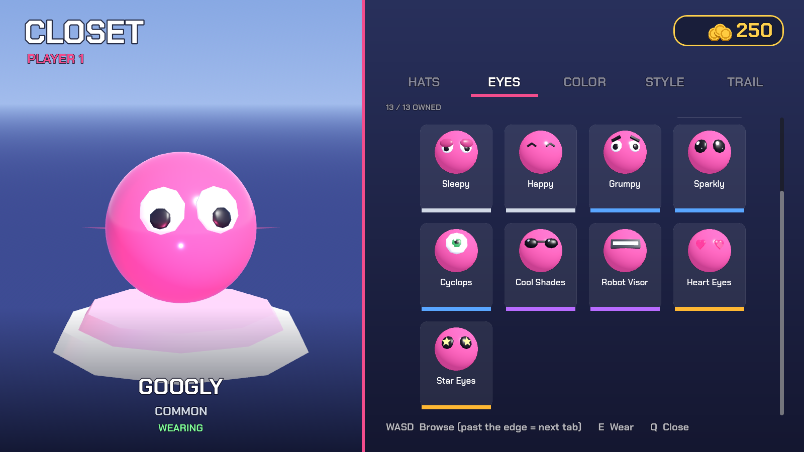

Roll onto the CUSTOMIZE plate on the hub and the closet fills the screen. Your marble spins on a pedestal on the left; on the right are five tabs, **HATS**, **EYES**, **COLOR**, **STYLE** and **TRAIL**, each a grid of cards with a little picture of the look. Your coins are in the top right corner.

- Move with your lean keys or stick. Up from the top row reaches the tabs, and pushing past the left or right edge of the grid flips to the next tab.
- Whatever you highlight is tried on the big marble straight away, even if you don't own it yet.
- Your place key (E for P1, A on a controller) wears a look you own. Locked looks are dark with a padlock: they only come from loot crates.
- The coloured strip under each card is its rarity: grey Common, blue Rare, purple Epic, gold Legendary.
- Your turn key (Q for P1, B on a controller) closes the closet and rolls you off the plate.

What's in it: 17 hats (party hat, beanie, ball cap, traffic cone, top hat, cowboy hat, chef hat, bunny ears, flower crown, propeller cap, pirate hat, viking helmet, rubber duck, wizard hat, crown and halo), 13 ball colours, 9 styles (Gloss, Stripes, Checkers, Chrome, Swirl, Neon, Glass, Lava, Galaxy) 5 trails (Ribbon, Sparkles, Bubbles, Flame, Rainbow) and 13 pairs of eyes. Everyone starts with no hat, four colours, Gloss, the Ribbon trail, and Classic eyes, Dots or no eyes at all.

### Eyes

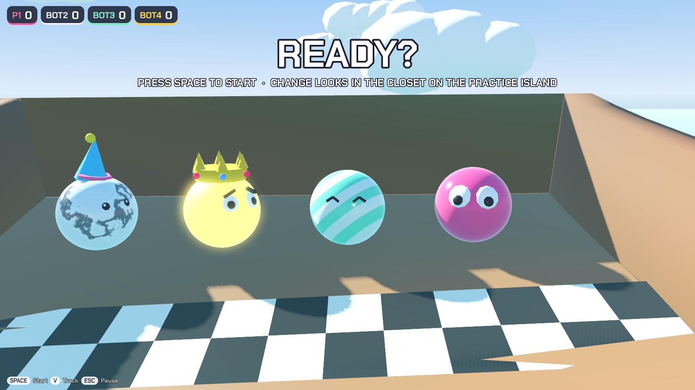

Every marble wears a pair of eyes by default. They sit on the front of the ball and stay turned toward the camera (leaning a little toward where the marble is heading) while the marble rolls underneath, the same way hats do. They blink every few seconds (sometimes a quick double blink), and they **squeeze shut in a wince** when the marble is knocked by another marble, hits a bumper or lands hard. Googly eyes' pupils wobble as the marble moves.

The eyes: Classic, Dots and None (everyone has these), Googly, Sleepy and Happy (Common), Grumpy, Sparkly and Cyclops (Rare), Shades and Robot visor (Epic), Heart eyes and Star eyes (Legendary). They're in loot crates like every other look. Eye shapes are built in `scripts/eyes.gd`; to add a pair, add it to `EYES` in `scripts/cosmetics.gd` and a branch in `EyeRig.setup()`.

### Loot crates

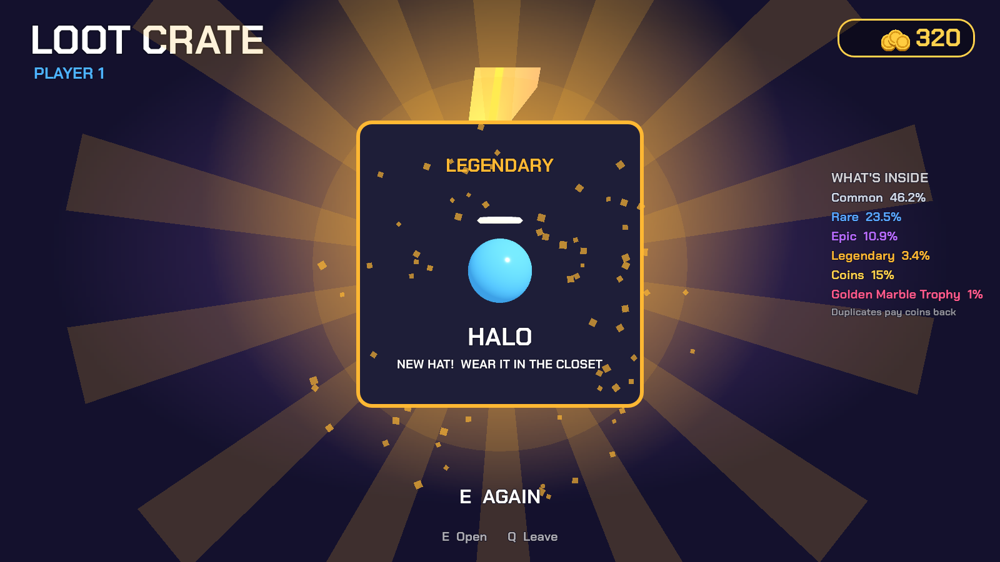

Every other look is won from loot crates at the casino. A crate costs **100 coins**. The lid pops and a reel of prizes spins past a gold marker, slowing down until it stops on what you won, then the prize card shows. The tiles are edged in their rarity colour, so you can see the rare ones fly past:

| Prize | Chance |
| --- | --- |
| A look: Common / Rare / Epic / Legendary | 46.2% / 23.5% / 10.9% / 3.4% |
| A pile of coins (50 to 200) | 15% |
| **Golden Ball Trophy** (ultra rare) | 1% |

A look you already own pays coins back instead (25 for Common up to 150 for Legendary). The Golden Ball Trophy isn't worn: it stands on your hub. The odds are shown on the crate screen, and live in `scripts/loot_crates.gd` if you want to tune them.

- **Coins:** you get 1 coin per pin you knock down and 1 per bonus point (race, sweep, knock-outs) each frame. At the end of a match you get a prize for where you finished (1st +50, 2nd +30, 3rd +15, 4th +5) and +10 just for finishing. The **COINS EARNED** screen after the podium shows the whole breakdown. The amounts are at the top of `scripts/profiles.gd`. New players start with 150, enough for one crate. The Ball Derby is another way to win (or lose) coins. Coins and looks are saved on this computer for each player seat (P1, P2 and so on). Bots don't earn coins. Online, your coins and looks are the ones on your own computer (P1's).
- Looks and rarities live in `scripts/cosmetics.gd`, hat shapes in `scripts/hats.gd`, and coin amounts in `scripts/profiles.gd`.

### The podium

When the match ends, the game cuts to a **FINAL STANDINGS** stage of its own: a dark room like the back of an old bowling alley, with a velvet curtain, a marquee of light bulbs, spotlights and two giant pins. The balls drop in one at a time, last place first: fourth lands in a trash can and shakes its head, then third, second, and finally the winner, who gets a gold medal hanging low on the front and a burst of confetti. After a few seconds the **COINS EARNED** screen shows what everyone won (hold Tab for the scores). It's built in `scripts/podium.gd`.

### STRIKE!

If a single player knocks down every pin in a frame on their own, a big **STRIKE!** in their colour bursts onto the middle of the screen before the scores come in. If the pins were shared between players, there's no banner.

### Strike replay

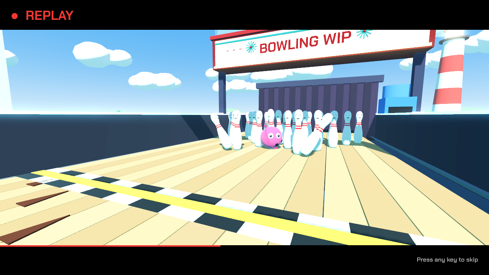

Before the STRIKE! banner, the game shows the strike again in **slow motion** from a low camera beside the pins. Black cinema bars slide in with a blinking red **REPLAY** tag, and a red line along the bottom shows how far through it is. It starts just before the first pin is hit, slows right down for the crash, and ends just after the last pin falls (about 5 seconds). **Press any key or button to skip it.** Then the STRIKE! banner and the scores carry on as usual.

How it works: while the marbles roll, `scripts/strike_replay.gd` notes where every marble and pin is, 60 times a second, keeping the last 8 seconds. For the replay it freezes everything and moves each piece back through those spots, blending smoothly between them, then puts everything exactly where the roll ended. Nothing is re-simulated, so the replay always matches what really happened.

Switch it off in **Settings > STRIKE REPLAY**. It doesn't play in online games yet (everyone would have to watch it at the same time).

The scoreboard then pops in and counts each player's new points up into their total one row at a time, with a "+N" flying off and the leader marked with a star.

### Pieces

Track-altering cards (**TAs** for short) are in the same draft pool as everything else. In the game they're marked **Track Altering**, with a gold badge and gold name on their cards. Every crate has at least one TA. They work a little differently from pieces:

- A start line in your colour (a stripe across the floor with a little flag on each wall) marks where the new stretch begins. You only slide it up and down the track, not side to side, and it moves a metre at a time.
- The new stretch shows as a see-through **gold** piece of track, walls and all, with white arrows showing which way marbles will roll. It gently pulses until you drop it.
- **Red** means danger: a gap's hole, walls a Wall Breaker will knock off, or the sides a Narrow Bridge takes away.
- A **dotted white line** shows where the rest of the track will swing to after the new stretch.
- For bends, hairpins and S-Bends, your rotate key flips the turn between **LEFT** and **RIGHT**. The floating label and your chip at the bottom of the screen say which way it's set.
- If the new shape would run into the track or the pin deck, the whole preview (and your start line) turns red and the label says **WON'T FIT HERE**. Slide it somewhere else.
- When you drop it, the changed stretch glows for a moment so everyone can see what happened.

Pieces further down the track move with it, and the pins move to the new end.

| Piece | What it does |
| --- | --- |
| Bumper post | Round post that kicks marbles sideways |
| Angled rail | Short wall that turns a marble 45 degrees |
| Ramp jump | Launches a marble into the air |
| Carpet strip | Drains speed from anything rolling over it |
| Booster pad | Fires a marble the way its arrow points (rotate it to aim) |
| Spinner | A paddle that never stops turning and swats marbles around |
| Gutter cut | A hole: fall in and your frame is over. Whoever placed it gets +2 |
| Curve wall | Curved wall that swings marbles across the lane |
| Ledge | Ramp up onto a ledge, then a sudden drop |
| Hump | Smooth hill across the lane that tosses marbles up |
| Washboard | Row of little bumps that make marbles hop and skid |
| Tilt table | A square of lane that rocks side to side |
| TA: Track Bend | Changes the track itself: adds a bend, left or right (rotate key flips it) |
| TA: Cliff Drop | Changes the track itself: adds a steep drop |
| TA: Hairpin | Changes the track itself: adds a tight U-turn, left or right (rotate key flips it) |
| TA: Gap Jump | Changes the track itself: adds a short gap that marbles have to hop over |
| Teleporter | Placed in two parts: drop the blue entry, then the orange exit (its arrow is the way marbles come out). A marble that rolls onto the entry pops out of the exit at the same speed. Each marble can use it once per frame |
| Wind Fan | A big fan that blows any marble in front of it the way it faces. It starts blowing across the track; turn it to blow marbles toward a wall, off an open edge, or down the track |
| TA: Wall Breaker | Takes the side walls off 10 m of track from where you drop it, without changing its shape. The walls that will go show red while you place it |
| TA: S-Bend | Changes the track itself: adds a wiggle, left then right (rotate key flips it to right then left) |
| TA: Narrow Bridge | Changes the track itself: adds a 9 m plank under 2 m wide with no walls. Steady marbles make it across; wobbly ones fall off. Pieces can't be placed on it |
| Bomb (item) | Drop it on the lane to blow up every piece inside the red circle. It doesn't stay |

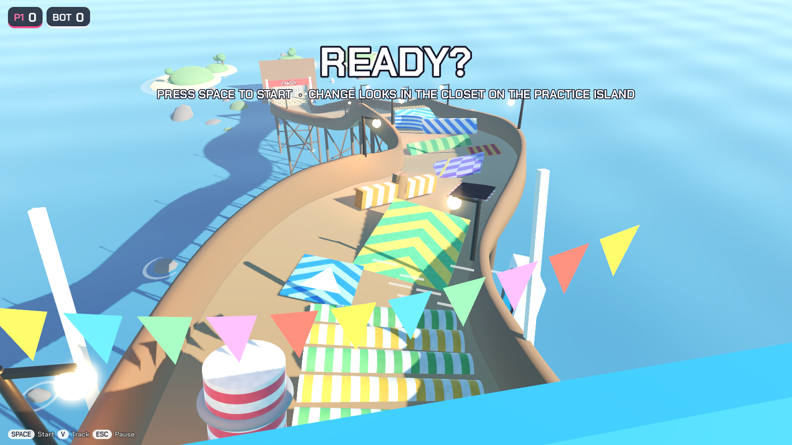

Every piece is painted like a wooden toy: candy-striped bumpers, chevrons pointing the way a booster or ramp pushes you, checks on the tilt table, wood grain on the spinner hub, hazard stripes on drops and holes. The paint is one shader (`shaders/toy_paint.gdshader`) and each piece's colours and pattern are a short entry in the `STYLES` list in `scripts/piece_style.gd`, so restyling a piece is just changing a few numbers there.

## How to play it

1. **Install Godot.** Download **Godot 4.4 or newer, the standard version** (not ".NET") from <https://godotengine.org/download>. On Windows it's a zip file: unzip it anywhere and double-click the `Godot_v4...exe` inside. There's no installer.
2. **Download this project.** On the GitHub page for this repository, click the green **Code** button, then **Download ZIP**. Unzip it somewhere you'll find it again, like your Documents folder.
   - To test a branch that isn't merged yet, first pick it in the branch menu (top left of the file list, it says `main`), then click **Code → Download ZIP**.
3. **Open it in Godot.** In the Godot Project Manager, click **Import**, browse into the unzipped folder, pick the `project.godot` file, and click **Import & Edit**. The first open takes a few seconds while Godot prepares the files.
4. **Press Play.** Click the ▶ button at the top right of the editor (or press **F5**). The game opens in its own window.

## Controls

Player 1's hop / place / grab key is **Space** (E still works too). Everything works with the keyboard or controllers, and the **Controls** page in the menu shows a drawn keyboard and controller with every binding. Players 3 and 4 use I J K L (U, O) and the number pad (8 4 5 6, 7, 9).

| | Player 1 keys | Player 2 keys | Controller |
| --- | --- | --- | --- |
| Menus: move / pick / back | W S or arrows / E or Enter / Esc | | D-pad or left stick / A / B |
| Closet: browse / wear / close | W A S D / Space / Q | Arrows / Enter / Right Shift | D-pad or stick / A / B |
| Loot crate: open / leave | Space / Q | Enter / Right Shift | A / B |
| Blackjack: wager / deal or hit / stand or leave | W S / Space / Q | Up Down / Enter / Right Shift | Stick / A / B or X |
| Bar: pick drink / order / leave | A D / Space / Q | Left Right / Enter / Right Shift | Stick / A / B or X |
| Draft: move pointer / grab | W A S D / Space | Arrows / Enter | Left stick / A |
| Build: move / rotate (flip for track cards) / place | W A S D / Q / Space | Arrow keys / Right Shift / Enter | Left stick / X or RB / A |
| Roll: lean / hop | W A S D / Space | Arrow keys / Enter | Left stick (analog) / A |
| Hub: roll / hop / leave a plate | W A S D / Space / Q | Arrows / Enter / Right Shift | Left stick / A / B or X |
| Hub: turn the camera | Z / X, or hold the right mouse button and drag; mouse wheel to zoom | | Right stick |

**Controllers:** controller 1 plays as P1, controller 2 as P2, and so on, in the order they were plugged in. You can switch between keys and controller at any time, and the hints at the bottom of the screen show whichever you used last.

| Key | What it does |
| --- | --- |
| **Space** (controller **Y**) | Start the match / go to the next frame |
| **Tab** (hold) (controller **Back**, hold) | Show the scoreboard |
| **R** | Re-roll this frame on the same lane |
| **C** | Turn marble-vs-marble collision on or off |
| **V** (controller **LB**) | Switch between the follow camera and an overhead view |
| **Esc** (controller **Start**) | Pause menu (resume, retry the frame, settings, or quit to the title screen) |

## Art direction (work in progress)

The look is **toy diorama**: soft, matte, low-poly shapes like painted wooden toys. The hub floats in a sunny sky with puffy 3D clouds (`scripts/art_style.gd`).

### Match worlds

Every match also gets a random track width (between 4.2 and 6.6 m, see `TRACK_WIDTHS` in `scripts/main.gd`), so no two starts feel the same. Every match picks one of five worlds at random for the scenery round the track: its own sky, ground, lighting, track colours and moving details. Online, the host picks and everyone sees the same one.

| World | What's there | File |
| --- | --- | --- |
| Beach island | Turquoise sea, palm islands with huts and a pier, a lighthouse with a turning beam, sailboats, a smoking volcano, gulls | `scripts/arena/arena_beach.gd` |
| City | Sunset city blocks with lit windows, roads, parks, neon billboards, traffic | `scripts/arena/arena_city.gd` |
| Crystal caverns | Dark cave with glowing gem clusters, cracks and pools, stalactites, mushrooms, mine carts on rails | `scripts/arena/arena_caves.gd` |
| Frosty village | Cottages with lit windows and chimney smoke, a church, a frozen pond with skating marbles, snowmen, falling snow | `scripts/arena/arena_snow.gd` |
| Cloud kingdom | Floating castle islands, a golden palace, rainbows, balloons, sparkles | `scripts/arena/arena_clouds.gd` |

To always get one world while you work on it, click the **Main** node in `scenes/main.tscn` and set **Force Theme**. The shared helpers are in `scripts/arena/arena.gd`, and `scripts/arena/mesh_batch.gd` merges lots of little shapes into one mesh so a big scene stays fast.

### The bowling end

The track finishes in a bowling alley: a maple lane with arrows, gutters either side, the pin pit with a curtain behind it, and a ball return. Marbles that drop into the pit roll back out along the return rail to the rack at the side, like bowling balls. It's built in `scripts/ball_return.gd`.

## Scoring

| Event | Points |
| --- | --- |
| Each pin your marble knocks down (a chain reaction counts for whoever started it) | 1 |
| Clean sweep: you knock down the last pin standing | +5 |
| First / second / third marble to reach the pins (yellow line) | +3 / +2 / +1 |
| Your piece knocks another player's marble out (gutter cut) | +2 |

If every marble reaches the pins, nobody gets the race bonus. If no marble reaches the pins in 30 seconds, nobody scores that frame.

## Tuning the feel

Most numbers you'll want to tweak are editable in the Godot editor without touching code. Click a node, then change the value in the **Inspector** panel on the right.

| What | Where | Setting |
| --- | --- | --- |
| Rescuing stuck marbles | `scenes/main.tscn`, `Main` node | Stuck Time, Rescue Time |
| Steering strength | `scenes/marble.tscn`, root node | Lean Side Force, Lean Forward Force |
| How snappy steering feels | `scenes/marble.tscn`, root node | Lean Attack (how fast a lean builds up), Lean Release (how fast it dies away), Counter Steer Boost (extra push when you steer against a slide), Spin Assist (how quickly the ball's spin catches up with where it's going, so it grips instead of skidding when you turn back; 0 turns it off). Turning from full speed one way to rolling the other way takes about 0.8 s |
| Who the camera follows | `scenes/main.tscn`, `Main` node | Camera Follow: All Marbles keeps every rolling marble in shot; One Marble follows only Camera Player's marble. Camera Shake sets how hard crashes shake the screen |
| How far the camera may pull back | `scenes/main.tscn`, `Camera` node | Frame Margin, Max Zoom, Zoom Out Speed, Zoom In Speed |
| How heavy the marble is | `scenes/marble.tscn`, root node | Mass (heavier scatters pins harder) |
| Bumper kick | `scenes/marble.tscn`, root node | Bumper Kick |
| Hop height and how often | `scenes/marble.tscn`, root node | Hop Speed, Hop Cooldown |
| How big pieces are | `scripts/piece_catalog.gd` | `PIECE_SCALE` (1.4). If you change it, scale each piece's `radius` the same way |
| Wind strength | `scripts/wind_fan.gd` | `push` |
| How long a Wall Breaker stretch is | `scripts/piece_catalog.gd` | `OPEN_LENGTH` |
| Lanterns and the START / FINISH gates | `scenes/course.tscn`, `Decor` node | Lantern Lights, Lantern Spacing, Arch Height |
| Which world a match is in | `scenes/main.tscn`, `Main` node | Force Theme (random by default) |
| Glow, fog and sunlight | `scenes/main.tscn`, `WorldEnvironment` and `Sun` nodes | Glow, Fog, Light Color |
| Pin weight and wobble | `scenes/pin.tscn`, root node | Mass, Center Of Mass |
| The shape of the track | `scenes/course.tscn`, `Track/Path` node | See "Reshaping the track" below |
| Track width, wall height, how much corners bank | `scenes/course.tscn`, `Track` node | Lane Width, Wall Height, Bank Speed, Max Bank Deg |
| Water colours | `shaders/water.gdshader` | The `uniform` lines at the top |
| Island sky, haze and cloud colours | `scripts/art_style.gd` | The constants at the top |
| A match world's sky, fog and light | `scripts/arena/arena_*.gd` | `make_environment()` and `light_sun()` |
| Players, frames, timers, crate size, collision | `scenes/main.tscn`, `Main` node | Player Count, Frames Per Match, Draft Time, Build Time, Crate Extra, Roll Time Limit, Marbles Collide |
| Build area and how close pieces can go | `scenes/course.tscn`, `Track/Placed` node | Half Width, Top Z, End Margin, Overlap Allowed |
| Build cursor speed and rotate step | `scenes/main.tscn`, `Main` node | Cursor Speed, Rotate Step |

### Reshaping the track

Random tracks come from `scripts/track_gen.gd`. To change how they're made, edit the numbers in `_random_segment()` there: how long bends are, how sharply they turn, and how steep drops are.

To play on a track you've drawn yourself instead, click the **Main** node in `scenes/main.tscn` and untick **Random Track**. Then reshape it by dragging points:

1. Open `scenes/course.tscn` and click **Path** (under **Track**) in the Scene panel.
2. Orange dots appear along the track in the 3D view. Drag one and the floor, walls and posts follow it straight away. Drag a dot up or down to make that part steeper or flatter.
3. To add a point, pick the **Add Point** button in the toolbar above the 3D view and click near the track. Use **Delete Point** to remove one.
4. Each point also has little handles. Dragging them changes how sharply the track curves through that point.
5. Keep the last stretch straight and lined up with the pin deck so the pin deck lines up, and keep the slope going downhill everywhere (about 10 to 20 degrees) so marbles never get stuck.

Tight corners send marbles over the wall, which is half the fun, but a corner sharper than about 4 m across will make the walls fold over each other.

### Fonts

Text uses one free font, under the SIL Open Font License (the licence files are in `fonts/`):
- **Chakra Petch** by the Chakra Petch Project Authors: Bold for titles and big numbers, SemiBold for everything else (set for the whole game in `ui/theme.tres`). Its cut, faceted corners suit the low-poly look.

## How the project is laid out

```
scenes/
  main.tscn          the game: lane, rack, camera, scoreboard
  course.tscn        the track curve and pin deck
  marble.tscn        a player's marble
  pin.tscn           one bowling pin
  pieces/            every lane piece, one scene each
scripts/
  main.gd            runs frames and the match (the "referee")
  marble.gd          lean steering and bumper kicks
  pin.gd             knocked-down check, who gets credit, and the pin's shape and face
  label_facing.gd    turns 3D words round so you never read them backwards
  rack.gd            sets up the 28 pins
  scoring.gd         the scoring rules, on their own
  piece_catalog.gd   the list of draftable pieces (add new ones here)
  draft_build.gd     draft and build rules
  cosmetics.gd       every marble look and its rarity
  hats.gd            builds the hat shapes
  eyes.gd            builds the eyes, and makes them blink and wince
  bot.gd             computer players (draft, build, roll, hub)
  net.gd             online play: hosting, joining, the lobby and what's sent
  loot_crates.gd     loot crate prices and odds
  closet.gd          the full-screen closet
  crate_screen.gd    opening a loot crate
  item_icons.gd      the little pictures of each look (and the trophy)
  profiles.gd        each seat's coins, owned looks and equipped look (saved)
  marble_trail.gd    marble trails (ribbon, sparkles, flame and so on)
  track_gen.gd       makes random track layouts and applies track cards
  track.gd           builds the track's floor, walls and posts from the curve
  course_builder.gd  the build area, placed pieces, and the bomb
  teleporter.gd      the two-part teleporter pad
  wind_fan.gd        the wind fan piece
  steam_config.gd    the Steam App ID (480 for testing; change it to yours)
  steam_service.gd   everything that talks to Steam: lobbies, invites, presence, achievements
  achievements.gd    the achievement list, unlocking and saving
  achievement_icon.gd  draws the achievement badges
  hub.gd             the hub (practice run, closet plate, trophies, PLAY arch, name tags)
  ball_return.gd     the bowling end: lane, gutters, pit and ball return
  strike_replay.gd   records each roll and plays a strike back in slow motion
  arena/             the five match worlds, one file each, plus shared helpers
  casino/            the casino island and blackjack
  sports_island.gd   the sports island: soccer pitch and scoreboard, trampoline and hoop
  jungle.gd          the hub's jungle: cliff walls, ruins, mushrooms, cave, waterfall, secret gems, critters
  low_poly.gd        shared helpers for building simple shapes, labels and confetti in code
  piece_style.gd     the painted-toy colours and patterns for every lane piece
  horse_race.gd      the Ball Derby betting minigame
  main_menu.gd       title screen, Play/Settings/Controls/Credits pages, pause menu
  game_settings.gd   saved settings (screen, sound, camera, match options)
  decor.gd           start/finish arches, lanterns, braces, rocks, islands, buoys
  thumbnails.gd      live pictures of each piece for the draft cards
  booster_pad.gd, carpet_strip.gd, gutter_cut.gd, spinner.gd, tilt_table.gd   piece behaviour
  controls.gd        all the key and controller bindings
  controls_diagram.gd  the drawn keyboard and controller on the Controls page
  art_style.gd       the shared look: sky, haze and puffy clouds
  cloud_layer.gd     drifting clouds (match and hub)
  camera_rig.gd      follow camera
  hud.gd             everything on screen: scores, draft cards, ready screen, STRIKE!, scoreboard
fonts/               the two fonts and their licences
addons/godotsteam/   the GodotSteam plugin, once you install it (see docs/STEAM.md)
steam/achievements/  achievement icons to upload to Steam
tools/               make_achievement_icons.gd (redraws those icons)
ui/theme.tres        default font and text size for all menus
shaders/
  marble.gdshader    marble patterns (stripes, swirl, galaxy, lava...)
  water.gdshader     the moving water
  toy_paint.gdshader the painted-toy finish on the lane pieces
  bowling_lane.gdshader  the maple boards, dots, foul line and arrows on the track
tests/
  test_scoring.gd    checks the scoring rules
  test_controls.gd   presses fake keys and controller buttons through menus, settings and a match
  sim_roll.gd        plays frames with no one at the keys and prints results
  sim_items.gd       tries the teleporter, wind fan, Wall Breaker, Narrow Bridge and S-Bend
  test_track_cards.gd  drops every TA card on a track and checks its preview and what it changed
  shot_ta.gd         screenshot of a TA card being placed (see the top of the file)
  test_strike_replay.gd  a strike plays the replay, any key skips it, everything ends up back in place
  shot_replay.gd     screenshot part way through a strike replay (not a test)
  sim_gap.gd         rolls over a gap, with or without well-timed hops
  sim_hub.gd         checks the hub's teleports, closet, a loot crate, derby bet and PLAY arch
  test_crates.gd     opens 100,000 crates and checks the odds (1% trophy and so on)
  sim_bots.gd        one idle person and three bots: checks bots draft, build and roll on their own
  test_achievements.gd  achievements unlock, count, save and reach Steam; the game runs fine with no Steam
  fake_steam.gd      a stand-in for Steam so tests can play over a "Steam lobby" without Steam
  sim_sports.gd      checks people-only island, name tags, a trampoline basket and a soccer goal
  sim_jungle.gd      checks the jungle: mushroom bounces, the hollow log, the cliff climb, secret gems and coins
  hub_view.gd        takes screenshots of the hub from any camera spot (not a test)
  net_host.gd, net_client.gd, run_net_test.sh   plays an online match between two copies of the game
```

`main.gd` makes every decision (physics, who arrived first, who gets each pin). Each seat is a person at this computer, a bot, or (online) someone on another computer, and their input only reaches the game through `seat_lean()` and `seat_pressed()`. Online, the host runs `main.gd` as usual and fills those in from the network; the other computers copy what the host sends.

### Running the tests (optional)

From the project folder in a terminal, with `godot` being the path to your Godot program:

```
godot --headless --script res://tests/test_scoring.gd
godot --headless --script res://tests/test_crates.gd
godot --headless --fixed-fps 120 --script res://tests/sim_roll.gd
godot --headless --fixed-fps 120 --script res://tests/sim_gap.gd -- hop
godot --headless --fixed-fps 120 --script res://tests/sim_bots.gd
godot --headless --fixed-fps 120 --script res://tests/sim_sports.gd
godot --headless --fixed-fps 120 --script res://tests/sim_jungle.gd
godot --headless --fixed-fps 120 --script res://tests/sim_plane.gd
godot --headless --script res://tests/test_achievements.gd
godot --headless --script res://tests/test_how_to_play.gd
godot --headless --script res://tests/test_track_cards.gd
godot --headless --fixed-fps 120 --script res://tests/test_strike_replay.gd
GODOT=godot tests/run_net_test.sh
GODOT=godot tests/run_net_test.sh steam
```
